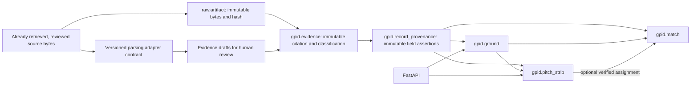

# Milestone 1 architecture and engineering decisions

## Repository inspection

Read all of `BALLX_CODEX_HANDOFF.md`, `SOURCE_REGISTRY.md`, and `SOURCE_INVENTORY.csv`
at main commit `f6f3f1672ea40204e8654597f4fc352fb33af909`. The repository had four files,
including a two-line README, with no application code, migrations, tests, Docker
configuration, or repository-specific agent instructions.

The handoff is a preliminary research specification: its eight source links include
four controlled/historic studies, while the CSV inventories four operational source
candidates. Neither list proves collection or redistribution permission. No source
is automatically seeded as licensed or collection-approved.

## Requirements extracted from the handoff

- Trace ground, strip, match, and research assertions back to evidence and sources.
- Distinguish a venue from every physical strip on its square. Unknown match strip
  assignments remain null; an unnamed but documented distinct strip can have a UUID
  with no local label.
- Separate raw payloads, cited observations, measured values, modeled values,
  proxies, experimental findings, and future predictions.
- Do not assign regional soil estimates to pitches. Weather reanalysis must retain
  its modeled classification and eventual grid/resolution metadata.
- Keep evidence immutable and retain corrections as new records. Version any future
  derived results and record their input evidence.
- Treat construction and deterioration taxonomies as provisional. No universal
  deterioration cutoff or image-to-swing causal model is established.
- Before a pilot, verify identities, dates, coverage, rights, conflicts, and field
  completeness for 20 grounds in India, Australia, and England.

The pilot acceptance work (Cricsheet subset, weather attachment, ICC ratings,
coverage audits, timestamped deterioration evidence) belongs to a later reviewed
milestone. None of it is implemented or executed here.

## One service, two database schemas

This is a modular monolith with synchronous SQLAlchemy/psycopg transactions. FastAPI
sync routes run blocking database operations in its thread pool. The app does not
create tables on startup; Alembic owns schema evolution. Compose adds a single local
PostGIS database and a one-shot migration process, plus isolated test containers.

| Model/table | Purpose and safeguards |
|---|---|
| `Association` / `gpid.association` | Cricket association name and jurisdiction |
| `Organization` / `gpid.organization` | Owner/operator identities with independent ground foreign keys |
| `Ground` / `gpid.ground` | Venue name, aliases, nullable coordinates, timezone, association, confidence; generated SRID 4326 point and GiST index |
| `PitchStrip` / `gpid.pitch_strip` | Physical strip linked to one ground and verified observed/measured identity evidence; nullable local identifier/construction/confidence |
| `Match` / `gpid.match` | Source-scoped provider match identity, format, gender, times, competition; independently nullable ground and strip |
| `DataSource` / `gpid.source_registry` | URLs, provider, terms, license, review date, access and permission metadata; unknown permissions remain null |
| `RawArtifact` / `raw.artifact` | Original bytes, media type, locator, retrieval time, adapter version, DB-enforced SHA-256, snapshot deduplication |
| `Evidence` / `gpid.evidence` | Citation/measurement JSON object, locator, dates, rights, review status, evidence type, optional artifact and superseded evidence references |
| `RecordProvenance` / `gpid.record_provenance` | Evidence-backed field/value assertions with exactly one real entity foreign key; conflicting assertions may coexist |

ORM/table primary keys are named `id`, corresponding to the handoff's `ground_id`,
`pitch_id`, `evidence_id`, etc. Foreign keys retain those domain names. UUIDs are
internal identifiers; they do not establish real-world identity. Ground names are
not unique globally. Provider match IDs are unique only within their source.

Pitch local labels are unique within a ground when present. Multiple null labels
are allowed only for documented distinct physical strips; identity deduplication
for unnamed strips still requires curation. A composite match foreign key enforces
that a selected strip belongs to the selected ground; a strip requires a ground.
No match is assigned to a strip automatically.

The generated point always uses longitude as X and latitude as Y. Confidence is
optional and bounded to [0,1]; no default score or validated cutoff is invented.
Dates use PostgreSQL `timestamptz`; adapter snapshots require timezone-aware input.
Ground timezones use IANA identifiers validated by the API.

Database triggers block UPDATE, DELETE, and TRUNCATE on artifacts, evidence, and
provenance. Strip creation also checks identity evidence in a database trigger.
Evidence linked to an artifact must have that artifact's source. Superseding an
evidence record preserves the original; downstream reconciliation remains manual
and does not silently rewrite normalized identities.

Ground/pitch API writes require verified observed/measured evidence and produce
provenance for each supplied non-null field atomically. API evidence review is a
metadata gate: curators remain responsible for identity and the actual support for
each field. Direct ORM/SQL imports must explicitly write field provenance; future
adapters cannot bypass that workflow safely.

## Adapter extension boundary

`IngestionAdapter` is a pure parser with a name and version, accepting an immutable
`SourceSnapshot` and returning classified `EvidenceDraft` objects. `AdapterRegistry`
rejects duplicate names. There is no network fetch method, scheduler, or provider
implementation. `store_snapshot` accepts already-retrieved bytes, requires explicit
reviewed collection permission, and uses a source/URL/hash conflict key for idempotency.
It leaves transaction ownership to its caller and never creates normalized records.

The initial raw store uses PostgreSQL bytea to keep this foundation small. Larger
artifacts, retention limits, external object storage, repeated-retrieval audit logs,
and parser-run history need a later capacity and provenance design. Identical
source/URL/hash snapshots retain the first retrieval metadata and adapter version;
they do not represent a new parser run or every retrieval event.

## Deliberately deferred schema

The handoff also names pitch measurements, deliveries, weather, pitch conditions,
ball-passport links, and derived features. These have no tables or jobs in Milestone 1;
their specifications and dependencies are recorded in [research blockers](research-blockers.md).
Source-supplied measurements can remain immutable evidence, but no normalized soil
measurement or prediction is generated. Experimental studies must not become
ground-specific measured values.

The API is a local curation interface without authentication, authorization, write
rate limiting, or rights-filtered publication. Production deployment, least-privilege
roles, backups, and operational retention are deferred and must precede public use.
